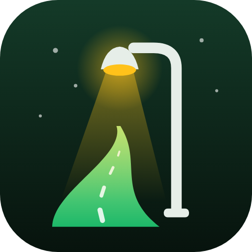
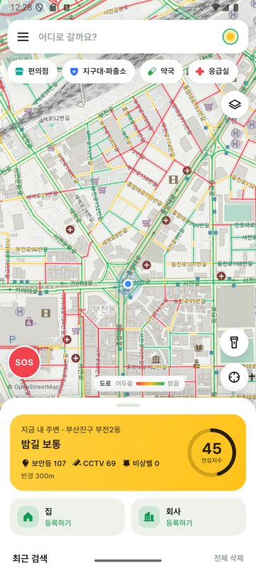
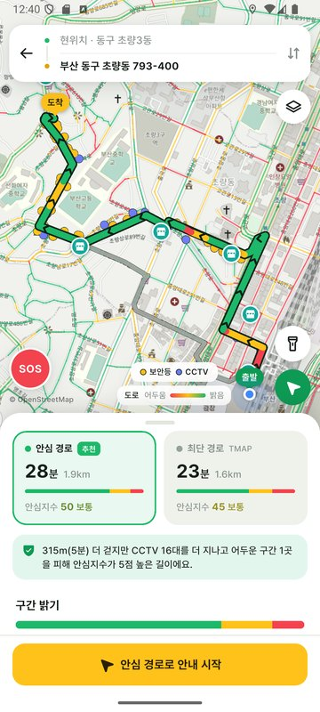
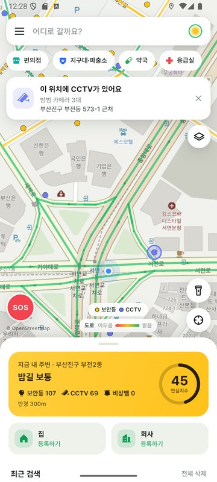
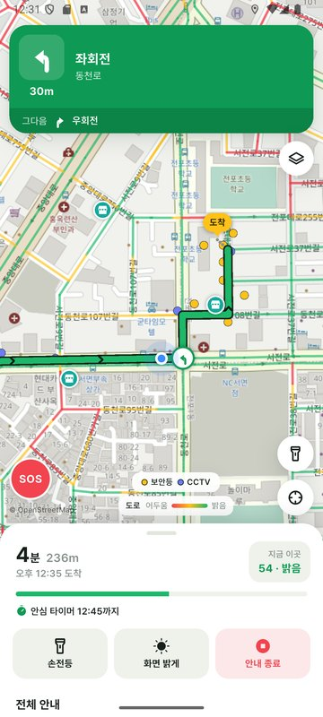
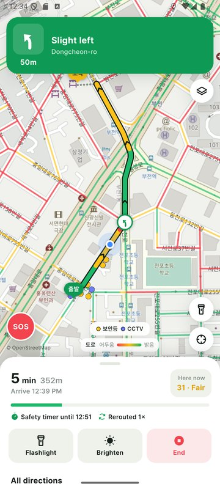
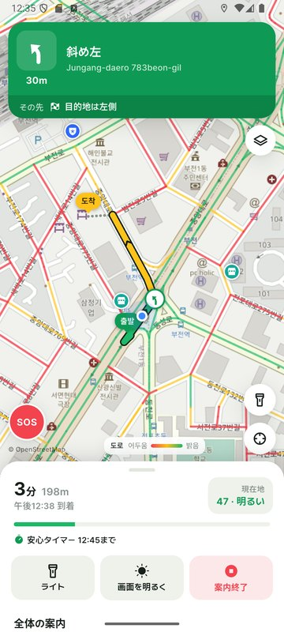

# 안심디디 (SafeDidi)

[](https://flutter.dev)
[](https://dart.dev)
[](https://developer.android.com)
[](https://www.openstreetmap.org)
[](https://www.data.go.kr)

### 부산 밤길, 가장 밝은 길로 안내하는 안심 귀가 앱

<p align="center">
  
</p>

---

* #### Features
    * 보안등 · CCTV · 비상벨 위치와 **도로별 밝기**를 지도 위에 표시
    * TMAP 최단 경로와 **안심 경로**(가장 밝은 길)를 같은 기준으로 비교
    * 네이버 지도 도보 안내를 참고한 **회전 안내** — 위 안내 카드 + 음성 + 진동
    * **한국어 · English · 日本語** 길 안내 (음성과 안내 화면)
    * 경로를 벗어나면 현위치에서 안심 경로 다시 찾기
    * 긴급 도움 — 112 전화·문자 신고, 보호자 문자, 흔들어서 SOS, 안심 타이머
    * 손전등 · 화면 밝게 · 밤에는 어두운 지도
* #### Stack
    * App: Flutter (Android), flutter_map, flutter_tts
    * Engine: 순수 Dart 패키지 `ansim_core` (안심점수, 공간 인덱스, 안전 가중치 A*, 회전 안내)
    * Data: 공공데이터포털 보안등·CCTV·비상벨, OpenStreetMap 보행 도로망
    * 서버 없음 — 경로 계산과 시설 조회가 모두 **기기 안에서** 실행

---

밤길을 걸을 때 지도 앱은 **가장 빠른 길**을 알려 줍니다.
하지만 밤에는 빠른 길이 골목 안쪽의 불 꺼진 길일 때가 많고, 조금 돌아가더라도 큰길로 가는 편이 마음이 놓입니다.

어느 길이 밝은지는 공공데이터에 이미 있습니다. 부산에만 보안등 73,240개, 방범 CCTV 21,053대, 안전 비상벨 203개의 위치가 공개되어 있습니다.
다만 이 숫자를 보고 직접 길을 고르는 사람은 없습니다.

안심디디는 이 시설들을 부산 보행 도로망 위에 올려 도로 하나하나의 **밝기 점수**를 매기고,
최단 경로보다 조금 더 걷더라도 훨씬 밝은 길이 있다면 그 길을 추천합니다.

<p align="center">
  
  
  <br>
  <sub>지금 내 주변 밤길 · 안심 경로와 TMAP 최단 경로 비교 · 지도의 점을 누르면 시설 정보</sub>
</p>

---

부산역에서 초량동 산복도로 쪽으로 걸어가는 경우를 생각해 봅시다.

* TMAP 최단 경로 — 23분 · 1.6km · 안심지수 45
* 안심 경로 — 28분 · 1.9km · 안심지수 50

두 경로를 같은 기준으로 채점해 차이를 한 문장으로 알려 줍니다.

```text
315m(5분) 더 걷지만 CCTV 16대를 더 지나고 어두운 구간 1곳을 피해 안심지수가 5점 높은 길이에요.
```

TMAP 경로가 오히려 돌아가는 길이면 문장도 바뀝니다.

```text
100m(2분) 더 짧은데 보안등 53개를 더 지나고 어두운 구간 2곳을 피해 안심지수도 33점 높아요.
```

경로 선은 도로 밝기와 같은 색(초록 밝음 · 노랑 보통 · 빨강 어두움)으로 칠해서, 어느 구간이 어두운지 지도에서 바로 보입니다.

---

### 길 안내

안내를 시작하면 네이버 지도 도보 안내처럼 회전할 곳마다 위쪽 카드와 음성으로 알려 줍니다.

```text
안심 경로 안내를 시작합니다. 약 7분, 498미터 거리이고 안심지수는 62점입니다. 서전로를 따라 289미터 직진하세요.
잠시 후 왼쪽 방향입니다            ← 약 50m 전
왼쪽 방향입니다                    ← 약 15m 전 + 진동
잠시 후 목적지입니다. 목적지는 왼쪽에 있습니다
목적지에 도착했어요. 목적지는 왼쪽에 있어요.
```

* 교차로(3갈래 이상)에서 30° 넘게 꺾이면, 교차로가 아니어도 60° 넘게 꺾이면 안내
* 횡단보도 · 육교 · 지하도 · 계단에 들어설 때 안내, 회전과 겹치면 "좌회전 후 횡단보도 건너기"
* 30m 안에 이어지는 안내는 한 번에 — "왼쪽 방향입니다, 이어서 횡단보도를 건너세요"
* 도로를 벗어나 목적지로 들어가는 곳에서는 목적지가 **어느 쪽에 있는지** 안내
* 40m 넘게 벗어나면 현위치에서 안심 경로를 다시 찾음

#### 다국어 안내

설정 → **길 안내 언어**에서 한국어 · English · 日本語를 고르면 음성과 안내 화면이 함께 바뀝니다.
부산을 찾은 외국인 유학생·관광객도 같은 안심 경로를 따라갈 수 있습니다.
도로 이름은 로마자(도로명주소 영문 표기 방식)로 보여 줍니다.

| | 한국어 | English | 日本語 |
| --- | --- | --- | --- |
| 50m 전 | 잠시 후 왼쪽 방향입니다 | In 50 meters, turn left | 50メートル先、左方向です |
| 15m 전 | 왼쪽 방향입니다 | Turn left | 左方向です |
| 회전 + 횡단보도 | 좌회전 후 횡단보도 건너기 | Turn left, then cross the crosswalk | 左折して横断歩道を渡る |
| 목적지 | 목적지는 왼쪽에 있습니다 | Your destination is on the left | 目的地は左側です |
| 도로 이름 | 중앙대로783번길 | Jungang-daero 783beon-gil | Jungang-daero 783beon-gil |

<p align="center">
  
  
  <br>
  <sub>같은 화면, 세 가지 언어 — 안내 카드 · 남은 시간 · 지금 이곳 밝기 · 안심 타이머</sub>
</p>

영어·일본어 문구는 부산교육 AI 튜터 **BeAT(비트)**로 검수합니다. 질문 프롬프트와 전체 문구표는 [docs/BEAT_PROMPTS.md](docs/BEAT_PROMPTS.md)에 있습니다.

---

### 안심지수

도로(OSM 보행 도로망의 한 구간)마다 0~100점을 매깁니다.

* 반경 안의 보안등 · CCTV · 비상벨을 거리에 따라 가중해 합산
* 큰길 · 상가 거리처럼 원래 밝은 도로 종류 반영
* 고속도로 · 자동차 전용도로 위의 보안등은 보행자와 무관하므로 제외 (163개)
* 45점 이상 밝음(초록), 25점 이상 보통(노랑), 그 아래 어두움(빨강)

경로의 안심지수는 지나는 도로 점수의 길이 가중 평균입니다.
지도의 도로 색, 경로 선 색, 안내 중 "지금 이곳" 점수, 안심 경로 탐색이 모두 **같은 도로 점수**를 씁니다.

안심 경로는 이 점수를 도로 비용에 반영한 A* 탐색으로, 최단 거리의 1.5배(+200m) 안에서 가장 밝은 길을 고릅니다.

---

### Usage

#### 키 준비

장소 검색(카카오 로컬)과 TMAP 보행자 경로에 키가 필요합니다. 지도는 키 없이 OpenStreetMap을 씁니다.

```bash
cd app
cp keys.example.json keys.json
```

```json
{
  "KAKAO_REST_API_KEY": "",
  "TMAP_APP_KEY": ""
}
```

| 키 | 쓰는 곳 | 없으면 |
| --- | --- | --- |
| `KAKAO_REST_API_KEY` | 장소 검색, 지도에서 고른 곳 주소 | 검색 불가 |
| `TMAP_APP_KEY` | 최단 보행 경로 | 앱이 직접 계산한 최단 경로와 비교 |

#### 실행

```bash
cd app
flutter pub get
flutter run --dart-define-from-file=keys.json
```

```bash
# 릴리스 APK
flutter build apk --release --dart-define-from-file=keys.json
```

자세한 키 발급·빌드는 [docs/BUILD_AND_SUBMISSION.md](docs/BUILD_AND_SUBMISSION.md),
데이터 갱신은 [tools/preprocess/README.md](tools/preprocess/README.md)를 참고하세요.

### Structure

```text
공공데이터 CSV ─┐
OSM 도로망 ─────┼─▶ tools/preprocess ─▶ app/assets/data/   graph.bin · facilities.bin · heat.bin
OSM 고속도로 ───┘     (전처리, PC)                          (앱에 내장, 약 16MB)
                                              │
                                              ▼
                     app (Flutter) ──▶ packages/ansim_core (순수 Dart)
                        │                  안심점수 · A* · 경로 비교 · 회전 안내 · 다국어 문장
                        ├─▶ 카카오 로컬 API   장소 검색
                        └─▶ TMAP API          최단 보행 경로
```

* `packages/ansim_core/` 엔진. Flutter 없이 `dart test`로 시험
    * `safety_model.dart` 안심점수, `router.dart` 안전 가중치 A*, `planner.dart` 경로 비교
    * `guidance.dart` 회전·횡단보도 안내, `guide_lang.dart` 한·영·일 안내 문장, `romanize.dart` 도로 이름 로마자
* `app/lib/` 화면(`ui/`), 안내 진행(`controllers/route_controller.dart`), 카카오·TMAP·위치(`services/`)
* `tools/preprocess/` 전처리(`preprocess.dart`), 실제 부산 경로 점검(`check_routes.dart`), 걷기 시연(`walk_demo.dart`)
* `docs/` 빌드 안내, BeAT 활용 프롬프트, 화면

### Development

```bash
cd packages/ansim_core && dart test          # 엔진 26개
cd app && flutter test                       # 앱 14개
cd tools/preprocess && dart run bin/check_routes.dart   # 부산 실제 경로 7곳 점검
```

에뮬레이터에서 걷기 시연 — 앱이 남긴 경로를 따라 에뮬레이터 GPS를 움직입니다(`DEMO_LOG=true` 빌드).

```bash
flutter build apk --release --dart-define-from-file=keys.json --dart-define=DEMO_LOG=true
cd tools/preprocess
dart run bin/walk_demo.dart --speed 8            # 초당 8m로 걷기
dart run bin/walk_demo.dart --speed 8 --detour   # 중간에 경로를 벗어나 재탐색까지
```

---

### NOTE

* 안심지수는 공공 안전시설 위치로 계산한 **참고 지표**입니다. 실제 안전을 보장하지 않습니다.
* 서버가 없습니다. 위치 기록을 저장하거나 따로 보내지 않고, 장소 검색·동네 이름·TMAP 경로를 요청할 때 필요한 좌표만 각 API로 보냅니다. 지도 타일은 OpenStreetMap 타일 서버에서 받습니다.
* 112 전화·문자와 보호자 문자는 사용자가 버튼을 눌렀을 때 휴대폰의 전화·문자 앱으로 넘깁니다.
* 키는 `keys.json`(Git 제외)에서 빌드할 때 넣습니다. 서버가 없어 키가 APK 안에 들어가므로, 각 콘솔에서 사용량 한도와 패키지 제한을 걸어 두세요.
* 영어·일본어는 길 안내(음성·안내 카드·안내 목록·도착 화면)에 적용됩니다. 장소 이름은 카카오 검색 결과(한국어) 그대로입니다.
* 일본어 음성은 로마자 도로 이름을 읽기 어려워 음성에서 도로 이름을 뺍니다. 화면에는 보입니다.

### Credits

* **공공데이터포털** — 전국보안등정보표준데이터(부산 16개 구·군), 부산광역시 방범용 CCTV 정보, 전국안전비상벨위치표준데이터 (이용허락범위 제한 없음)
* **OpenStreetMap** — 보행 도로망·지도 타일 © OpenStreetMap contributors (ODbL 1.0)
* **카카오 로컬 API** — 장소 검색 · **SK open API TMAP** — 보행자 경로
* **[Pretendard](https://github.com/orioncactus/pretendard)** — 글꼴 (SIL OFL 1.1)
* **[Phosphor Icons](https://phosphoricons.com)** — 아이콘 (MIT)
* **부산교육 AI 튜터 BeAT** — 영어·일본어 안내 문구 검수
